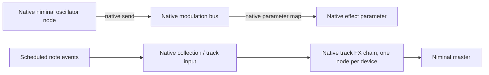

# Audio ownership

Niminal owns all DSP, audio buffers, mixing, parameter interpolation, oscillator state and audio routing. The tracker owns project data, pattern editing, command interpretation and sample-clock event scheduling. UI timers paint state; they do not drive audio or modulation signals.

A musical track is represented by native niminal routing resources. Notes target its engine collection node. Track pre-volume/pan use native fx parameters. Insert effects are native fx instances connected with native routing edges. Mute uses a native connection gain. Shared code definitions may have many independent native instances.

Track modulation uses the existing native bus-mapping API:

The tracker creates protocol descriptions of these resources. The LFO waveform is niminal code compiled by niminal, not samples or modulation values generated by the client. Tempo synchronization only converts rows-per-cycle into an engine oscillator frequency. Modulation FX request `output_channels: 1` through the native routing API, independent of the audio master. Play sends a sample-timed native `reset` edit; parameter maps use niminal's bus semantics, including block delay.

A track's effects are separate niminal `fx` definitions chained by named routing connections (`link_<track>_<device>`); the chain is rebuilt in place when devices are added, moved, bypassed or removed, and each device keeps a stable node name. Imported samples live in a per-project folder that is passed to the engine as the definition directory.

Every track and the master is a *strip*: `track_<s>` (level, pan; notes play into it) → effect devices → `tap_<s>` (a pass-through, so a scope has one steady place to listen) → `out_<s>` (mute and solo) → the master's `track_m`, which feeds the engine output. The tracker opens one engine scope per tap, collects the frames the engine pushes, and serves the latest to the UI.

A pattern holds note columns per track, each with parallel cell arrays (note, instrument, volume, pan, delay). The scheduler turns a note into one engine `note` event whose `dur` runs to the next note or OFF in the same column, looking ahead across pattern boundaries (and wrapping when a pattern loops); volume and pan become the note's `gain` and `pan`, and delay shifts its start. Instrument parameters are the compiled instrument's controls: values and lane state are sent as note arguments, so they are fixed for the life of each note.

Up to four *return* strips (`r0`–`r3`) have the same shape as a track strip and feed the master. A track's or return's tap feeds the master through `out_<s>` or one return's `track_r<n>` through `outr_<s>_<n>`, whichever its `output` names (or neither, for `none`); a muted or soloed-out strip, or a missing return, sets those gains to zero. A return can only feed a later return, so the graph has no loops. A *send* is a device with a `target`: its node takes the chain's signal at its position without carrying the chain on, and a native connection `sendout_<t>_<device>` feeds the target return, gated the same way; on a return it must be a later one. Its amount is the device's own `amount` parameter, so lanes, envelopes and LFOs reach it like any other. Sends are post-fader. The master has neither. Returns have a level, pan, mute and effect chain but no pattern lanes. The tracker adds no mixer or renderer of its own; if the engine protocol needs a missing primitive, add it to niminal and test it there.

Graphical envelopes address the same named native parameters as row lanes. The scheduler divides a row at envelope points and sends sample-timed native sets/glides for each segment; niminal generates the ramps. UI interpolation only previews those native glides. Additional targets, instrument macros and modulation devices should address the same native parameters. Per-note envelopes belong to niminal instrument definitions/voice controls; they must not be approximated by changing a shared track parameter.

Renoise references informing the UI/data model:

- [Effect Commands](https://tutorials.renoise.com/wiki/Effect_Commands): compact row commands and device/parameter addresses.
- [Graphical Automation](https://tutorials.renoise.com/wiki/Graphical_Automation): parameter envelopes are a second editing view.
- [Meta Devices](https://tutorials.renoise.com/wiki/Meta_Devices): LFOs and signal followers target other parameters.
- [Sampler Modulation](https://tutorials.renoise.com/wiki/Modulation): per-note modulation is distinct from track modulation.
