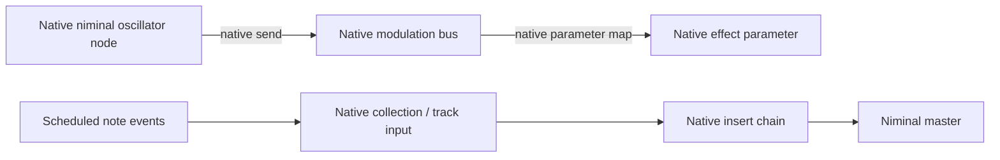

# Audio ownership

Niminal owns all DSP, audio buffers, mixing, parameter interpolation, oscillator state and audio routing. The tracker owns project data, pattern editing, command interpretation and sample-clock event scheduling. UI timers paint state; they do not drive audio or modulation signals.

A musical track is represented by native niminal routing resources. Notes target its engine collection node. Track pre-volume/pan use native fx parameters. Insert effects are native fx instances connected with native routing edges. Mute uses a native connection gain. Shared code definitions may have many independent native instances.

Track modulation uses the existing native bus-mapping API:

The tracker creates protocol descriptions of these resources. The LFO waveform is niminal code compiled by niminal, not samples or modulation values generated by the client. Tempo synchronization only converts rows-per-cycle into an engine oscillator frequency. Modulation FX request `output_channels: 1` through the native routing API, independent of the audio master. Play sends a sample-timed native `reset` edit; parameter maps use niminal's bus semantics, including block delay.

Future auxiliary FX tracks should be native send/return buses: source-track routing sends audio into a niminal bus, a native return effect chain processes it, and native routing returns it to the master or another permitted destination. The tracker should expose those existing resources rather than add an internal channel mixer or renderer. If the engine protocol needs a missing primitive, add it to niminal and test it there.

Graphical envelopes address the same named native parameters as row lanes. The scheduler divides a row at envelope points and sends sample-timed native sets/glides for each segment; niminal generates the ramps. UI interpolation only previews those native glides. Additional targets, instrument macros and modulation devices should address the same native parameters. Per-note envelopes belong to niminal instrument definitions/voice controls; they must not be approximated by changing a shared track parameter.

Renoise references informing the UI/data model:

- [Effect Commands](https://tutorials.renoise.com/wiki/Effect_Commands): compact row commands and device/parameter addresses.
- [Graphical Automation](https://tutorials.renoise.com/wiki/Graphical_Automation): parameter envelopes are a second editing view.
- [Meta Devices](https://tutorials.renoise.com/wiki/Meta_Devices): LFOs and signal followers target other parameters.
- [Sampler Modulation](https://tutorials.renoise.com/wiki/Modulation): per-note modulation is distinct from track modulation.
